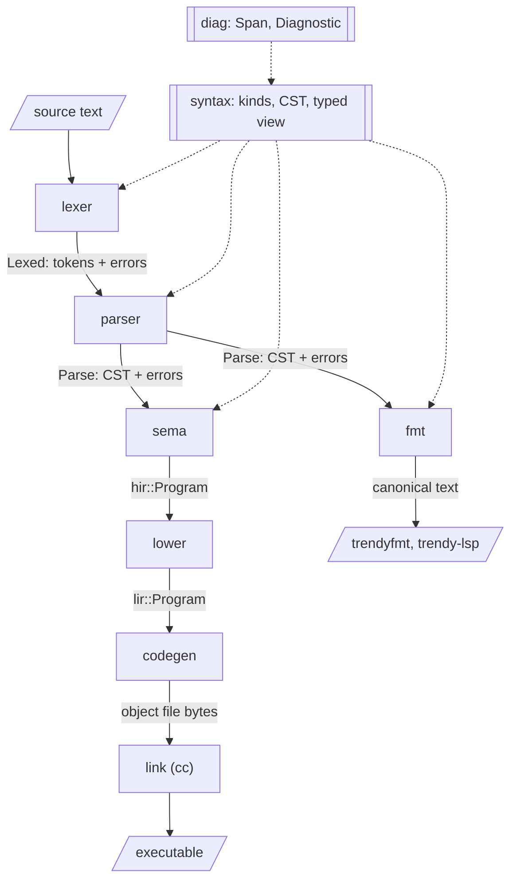

# Compiler pipeline

The compiler is split into layers, and each layer is a separate crate. A
layer reads the output of the layer above it and produces the input for the
layer below. Layers never call each other: small programs called drivers
connect them. `trendyc` is the compiler driver, and the formatter and language
server are drivers that reuse the front-end layers.

This document is about the compiler. For the language itself, see
[`language.md`](language.md).

### The prelude and the runtime

**`trendy_prelude`** holds the prelude: trendy source declaring the built-in
types and operators, and defining operators in trendy, all part of every
program. Drivers parse it next to the program. Sema checks every
declaration against what the compiler implements (`hir::Builtin`, and the
scalar types), then checks the prelude's own operators, with only the
built-ins in scope, once, as a program's are (`sema::Source::Prelude`), and
gives every program them as checked HIR. A built-in with a result type is
read-only, and its call is a value, which sema evaluates when compiling
where its arguments are known (`hir::Builtin::evaluate`), and lowering
computes inline otherwise: `count` and `length` are the count every
relation keeps after its tuples, and every array after its elements, `min`
and `max` a loop over them (`extreme`), which
ends the block with `Terminator::Fail` for none (R0010), and
`to_approximate` an instruction (`UnaryOp::Approximate`). `sum` and
`product` are runtime calls (`trendy_rt_sum`, `trendy_rt_product`), which
walk the relation by its descriptor, and compute as sema folds them, with
`trendy_numeric`. `debug_value` and `debug_table`, update operators, are runtime calls
given their argument and its type's descriptor (`trendy_rt_debug_value`,
`trendy_rt_debug_table`). `to_text` is
a runtime call, which writes the value as `debug_value` does; folded, it
is `hir::Value`'s source text, which writes values the same way. Since
that text has the value's type in it, as an empty relation's heading, a
built-in isn't evaluated when compiling on an argument whose type has a
type parameter, but for each list of types. A built-in can
have type parameters, of a kind too, and `per` parameters, declared as an
operator's are, and checked against the compiler's, written as the
operator sees them. A wrong prelude is an internal
compiler error, and the tests keep it valid: a declaration that doesn't
match the compiler is reported at it (X0000), and an error in an operator
the prelude defines as it would be in a program. The language server
checks the file at `trendy_prelude::SOURCE_PATH`, where the prelude was
when it was built, as the prelude, not as a program. A built-in is added in three
places: its declaration in `prelude.trendy`, its `hir::Builtin` entry, and
its implementation, which is usually in the runtime. Built-ins are kept as
few as possible: an operator that can be written in trendy is defined in
the prelude instead, and each new language feature is a reason to look for
a built-in it can replace.

**`trendy_runtime`** is a `no_std` library linked into every executable. It
links only the C library, and of the crates outside the workspace uses
only `unicode-width`, for the columns a terminal gives a table's cell
(UAX #11), which a wide character, such as `李`, takes two of. `trendyc`'s `build.rs` builds it as a static library
(`cargo rustc --crate-type staticlib` with `panic = "abort"`, in a target
directory of its own), embeds the archive, and passes it to `cc` with the
object. **`trendy_text`**, `no_std` and dependency-free, holds the escape
rules for text literals, so the compiler, which reads them and writes them
in messages and in `to_text`'s folded values, and the runtime, which writes
them, can't disagree. **`trendy_numeric`**, the same, holds the exact sums
and products that `sum` and `product` fold and run with, each rounded once
at the end (`nearest`), so that neither depends on the order of a
relation's tuples, which has no meaning. A sum of integers is an `i128`,
and of approximate numbers a fixed-point accumulator of every finite
binary64 (a Kulisch accumulator). A product of integers is zero with a
zero, and otherwise out of range once a partial product is, since the rest
only grow it. A product of approximate numbers keeps the highest 128 bits
of the significands' product, with the exponent apart, and counts the
steps that dropped bits, which bounds the exact product above: if the
bound rounds as the kept bits do, that is the product. Otherwise, within
about 2^-74 of halfway between two approximate numbers, it is worked out
in full (`Exact`), in memory the caller gives, which the runtime allocates
and frees, and in time quadratic in the number of factors.



The front end never stops at the first error. The lexer and parser always
produce a complete, lossless syntax tree and collect every error along the
way. The compiler stops after parsing if there were any errors, but the
language server keeps the tree so it can still answer questions about the
file.

## Layers

### diag (`trendy_diag`)

**Provides:** `Span`, a byte range in the source, and `Diagnostic` (see
[Diagnostics](#diagnostics)), along with the error `Code` registry and its
explanations. It renders diagnostics both as text with source excerpts and as
JSON.

**Must not:** know about any other stage. Every front-end layer depends on it,
so it stays at the bottom of the graph.

### syntax (`trendy_syntax`)

**Provides:**
- `SyntaxKind`, the kind of every token and node.
- The concrete syntax tree (CST), and `TreeBuilder` for constructing it.
- A typed view over the tree (`ast::SourceFile`, `ast::Operator`, …) with
  accessors that return `Option`, because a tree with errors can be missing
  any part.
- `literal`, the meaning of literals: the escape table, the integer syntax,
  and decoding. The lexer uses it to report malformed literals, and sema uses
  it (through `ast::Literal::value`) to decode them, so the rules exist in
  one place.

The CST is lossless. It holds every byte of the source, including whitespace
and text that failed to parse, so printing it reproduces the input exactly.

**Owns:** the tree representation, which is built on `rowan`. **Must not:**
let `rowan` leak. No other crate may depend on it, so it could be replaced
without touching any other layer.

### lexer (`trendy_lexer`)

**Input:** source text. **Output:** `Lexed`, the tokens plus an error for each
unrecognized character and malformed literal.

The tokens cover the source exactly, whitespace included. Each token is a kind
plus a span, and doesn't copy its text out of the source. The lexer never
fails: an unrecognized character becomes an error token, and lexing
continues.

**A malformed literal keeps the kind it was meant to have.** For example,
`1_000` is still an integer literal, `1.5`, which lacks an exponent, is
still an approximate literal, and `"abc` is still a text literal, so the
parser accepts them, and the mistake gives one error, not a cascade. An
unterminated text literal ends at the end of its line, or just before a final
`;` on that line, which is most likely where the closing quote was meant to
go.

Comments are trivia, like whitespace: the parser skips them, and they stay
in the CST. They nest, so the lexer counts `/*` and `*/` within one. An
unterminated comment runs to the end of the source (P0012, with each
unclosed nested opener labeled), and a `*/` outside a comment is an error
(P0016), except in `*/*`, which is `*` followed by a comment.

**Owns:** what counts as whitespace, comments, identifiers, keywords,
literals and punctuation.
**Must not:** know the grammar. It never looks at more than one token at a
time to decide anything.

### parser (`trendy_parser`)

**Input:** source text and `Lexed`. **Output:** `Parse`, the CST plus every
lexer and parser error, ordered by position.

**Owns:** the grammar, using recursive descent with one token of lookahead,
and a few more only to recognize another language's spelling.
It never fails. A missing token is reported and the parser carries on, and
text that fits nowhere is wrapped in an error node, up to the next definition
keyword (`operator` or `var`). In a variable declaration, a missing `:` or
`:=` is recognized from the type or value that follows it, and `=` is parsed
as `:=` and reported. A variable's keys, `key { a, b }`, follow its value,
or its type when it has none; `key` is a contextual keyword, recognized
only there, before `{`. Keys written before the value are parsed and
reported with a fix that moves them (P0020), and SQL's `primary key` and
`unique` are parsed as keys and reported (P0019). Whitespace is attached to the innermost node that is open when it
appears, so whitespace between definitions belongs to the file.

Expressions use precedence climbing. From tightest to loosest: the prefix
operators `not`, `-` and `+`; `*`, `/`, `div` and `mod`; `+`, `-` and
`||`; the joins, `join`, `times` and `compose`; the comparisons, which don't chain (P0015, with a fix that compares
the middle operand twice); `and`; `xor`; `or`; and `implies`, which groups
to the right. Since `not` binds tightest, `not n = 0` on an integer is a
type error, whose fix negates the comparison instead: `not (n = 0)`. Looking for
a dyadic operator after an operand uses a lookahead that leaves whitespace
unattached, so whitespace after the last operand belongs to the node that
continues, not to the expression. The symbols of other languages (`&&`,
`!`, `->`, …) are lexed as `ForeignOperator` tokens, and they and
capitalized keywords (`AND`) are parsed as the operator they stand for and
reported with a fix. SQL's joins are recognized the same way (P0021):
`natural join`, `inner join` and `cross join` are parsed as the join they
stand for and fixed to it, and the outer joins as `join`, with no fix,
looking up to three tokens ahead. SQL's `on` condition or `using` list after a
join's right operand is consumed into an error node, so the next join still
parses, and reported. SQL's `group by {…}` after `group` is consumed into
an error node the same way, with no fix. The list of an `extend`, a
`replace` or a `group` in brackets is parsed as it is, and a check of the
finished tree (`sequences`) reports it: its items apply all at once, so
the fix for an order asked for with brackets is a chain of the operator,
not braces, which would change the meaning. A relation selector's elements are any expressions, a bare `{` or `tuple`
starting a tuple selector, as Tutorial D's take any tuple expressions. A join of a list, `join{r, s, t}`, `times{…}` or
`compose[…]`, is an operand (`NaryExpr`), recognized where an operand
starts by the keyword followed by `{`, `[` or `(`. Braces enclose what can
be in any order and brackets what can't, so join's and times's operands
go in braces, and compose's in brackets; the others are fixed to them
(P0003).

`extend` and `replace`, like `remove` and `rename`, are postfix, and take a
list of attribute assignments, each `name := value` (`Assign`), new
attributes for `extend` and existing ones for `replace`. A tuple's
`name: value` and keyword arguments' `name = value` are parsed as the
assignment meant and fixed to `:=`, and SQL's and Tutorial D's `value as name` to
`name := value` (P0011). A value with no name is reported without a fix,
since the name can't be guessed.

A statement is a call, an assignment statement (`AssignStmt`), an
`assign` block (`AssignBlock`) of assignment statements, made at once, or a
`return` (`ReturnStmt`), for leaving an operator early, which sema
rejects until there are early exits. An
assignment is `target := value` (`Assignment`) or a shorthand starting
with its keyword:
`insert` and `d_insert` (`Insertion`), `delete` and `i_delete`
(`Deletion`), and `update` (`Update`). An assignment's target is a name,
then any positions and attributes (`Parser::assignment_target`), each an
`IndexExpr` or an `ExtractExpr` around what is before it, as in
`grid[i][j]`: an array's element, which sema checks, or an attribute,
which it reports. A statement starting with a target and `:=` or `=` is an
assignment, `=` fixed to `:=` (P0005). A `delete`'s
condition and an `update`'s are all that follows `where`, as in an
expression, which is why an `update`'s new values come before it. Other
languages' habits are parsed as what they mean and fixed: Tutorial D's
capitals; SQL's `insert into`, `delete from` and `update … set a = x`
(P0021); Tutorial D's `update r where p (a := x)` (P0024); and its
multiple assignment, separated by commas, which is parsed into one
statement and fixed to a block (P0025); and C's and Python's `x += y`,
`x++` and `--x`, their operator's characters written together, fixed to
the assignment they mean, the value parenthesized where the operator
would take only part of it (P0036). Anything but an assignment in a
block is reported and skipped, up to its `;`. A `delete`
without `where` is reported, with the assignment Tutorial D's would mean
as the fix (P0023).

What starts a statement is decided in one place
(`Parser::statement_start`), which a statement's start and its end both
use. An expression where a statement starts, as C and JavaScript allow
one, is parsed, so that an error in it is reported instead, and is
otherwise reported without a fix, since its value might be kept or
written (P0035). Anything else is a missing statement (P0002). A
statement that ends before an expression that can't start another, as in
`n := 1 2;`, is reported without inserting its `;`, which alone wouldn't
make the code right, and skipped to its `;`: after a value, which
`Parser::value_end` tells, an operator may be what's missing instead.

A read-only operator has its result type after its parameters, as a
`TypeAnnotation`, and its body ends with its value: an expression, a child
of the `Body`, without `;`. The parser knows the body is a read-only
operator's from the result type, and reads an operand that doesn't start a
statement as the value: an `if`, or `a = b`, that runs to the `]` with no
`;` is the value, an `if` expression and a comparison, and otherwise an
`if` statement and `=` for `:=`. Loops are statements of their own:
`while c loop [ … ];` (`WhileStmt`), `loop [ … ] while c;`
(`LoopStmt`) and `for x in a loop [ … ];` (`ForStmt`, whose `in` is a
contextual keyword), whose blocks are bodies, parsed and fixed as an `if`
statement's branches are, and whose other languages' spellings are fixed
(P0032). A `{` after an operand with a `;` or `:=` right inside it is a
block, as C writes one after a condition, not a projection.
A `;` after the value, and a value before other statements, are reported
(P0031), and so is `return x;` at the end, which other languages write,
parsed as the value it means. Other languages' spellings of the result
type, `-> type` and `returns type`, are fixed to `: type` (P0026). A call of one in an
expression (`CallExpr`) is a name before arguments that a projection
can't have: named ones, `f{a: x}`, or one starting with a value, `f{1}`,
which sema reports. `f{}` and `f{a}` stay projections (`ProjectExpr`),
and sema makes them calls of an operator; the parser can't, since it
doesn't know what names are. A name before `(` is a call too, as other
languages write one, fixed to braces (P0003), except in the condition of
Tutorial D's `update r where p (a := x)`, whose values follow it
(`Parser::paren_calls`).

An operator's type parameters follow its result type, `types { T: any type }`
(`TypeParameters`), a heading whose types sema requires to be `any …`.
`types` is a contextual keyword, recognized there before `{`, and `any`
another, recognized in a type before a name, `type` or a kind's, or the
keyword `tuple` or `relation` (`AnyType`). `kind name { < };` (`KindDecl`)
is a definition of its own, `kind` a contextual keyword recognized at a
definition's start before a name and `{`, and a built-in type can list
its kinds, `builtin type integer: { ordered };`. Elsewhere all three are names,
and a bare `any` is a type's name, which sema reports. Type parameters in
angle brackets after the operator's name, `f<T, U>{…}`, are consumed up to
the matching `>` into an error node and reported once the result type is
parsed, with a fix that moves them to `types` there, if they are only
names (P0027); `relation any` and `tuple any` are parsed as what they
mean and fixed the same way. In a heading, `per r` can follow an
attribute's type (`Per`), `per` a contextual keyword recognized there
before a name; looking for it leaves the whitespace after the type to what
follows. The parser accepts it in every heading, and sema in an operator's
parameters only.

`heading name := { … };` (`HeadingDecl`) is a definition, `heading` a
contextual keyword recognized at a definition's start before a name.
After `relation` or `tuple`, in a type or a selector, a name in place of
the braces is a declared heading's (`HeadingRef`); `ast::HeadingExpr` is
either, and `HeadingRef::declaration` finds the declaration by name in
the file, the first with it, as sema's namespace keeps. Other languages'
declarations of a type of records, TypeScript's `type Home = {…}` and
`interface Home {…}` and C's and Rust's `struct Home {…}`, are parsed as
a heading's, reported once with a fix that makes them one (P0004).

`!!r` (`ImageExpr`), Tutorial D's image relation, takes a single operand:
a name, a literal or a parenthesized expression. The lexer makes `!!` one
token only when the two `!`s are together; a lone `!` is C's `not`, fixed
to `not` (P0014). C's `!!x` never means an image by mistake, since its
operand is a boolean, which an image relation's never is.

Precedence is a partial order. Where a pair of operators could be read
either way, the grammar still builds one reading, so recovery goes on,
and a check of the finished tree (`unordered`) reports the pair (P0022),
with a suggestion for each reading. So far that is `!!` followed by
a postfix operator or a join, which could apply to the image or to its
operand; chained comparisons (P0015) are reported as they are parsed.
An operator that could make a new such pair, such as a prefix relational
operator, is checked against this when it is added.

**Must not:** resolve names, check meaning, or reject a program that is
grammatically valid. For example, "no `main`", "duplicate name" and "unknown
type" are sema errors, not parse errors.

### fmt (`trendy_fmt`)

**Input:** the CST of a file with no syntax errors. **Output:** the file as
text in canonical style.

**Owns:** the language's layout. Whatever this crate prints is, by definition,
the official style. **Must not:** depend on sema. Formatting is purely
syntactic, so a program that parses but has semantic errors can still be
formatted.

The canonical layout is one definition per line. Consecutive variable
declarations go on adjacent lines, unless the source separates them with a
blank line to group them, in which case one blank line is kept. Other
definitions are always separated by a blank line. This is the only place the
formatter looks at the original whitespace.

A variable's keys stay on the line before them when they fit. After a
value that spans lines, or when that line would be too long, each key goes
on a line of its own, in the declaration's column, which is also the column
of a relation value's closing brace, and a blank line follows them; a too
long line breaks its keys before any list in it.

An `assign` block is laid out like an operator's body: each assignment on
its own line, indented, and `};` on a line of its own. An operator's type
parameters go on a line of their own, one level in, their braces spaced as
a heading's, and then its body's `[` on a line of its own, in the
operator's column.

Everything else goes on one line, except that a relation value with more than
one tuple is broken across lines: each tuple on its own line, indented four
spaces per level of nesting, with the closing brace on a line of its own.
A tuple value, relation value or call's arguments with several items, one of
them broken, puts each item on its own line too, and so does one with a
broken chain in it outside any block. Lines are at most 100
characters: the formatter lays everything out, then breaks the outermost
unbroken list on the first line that's too long, one item per line, or
`if` expression, its `then` and its `else` each starting a line, or chain
of dyadic operators of one precedence (`SyntaxKind::precedence`, which the
parser parses by), each operator starting a line, a list before a chain
beside it, and repeats until every line fits or none can be broken
further. An `if` with a part that spans lines is broken too, and an
`else if` with the `if` it is in. A block of an `if` statement, as an
operator's body, has each statement on its own line.

Indentation follows the lines as they are written, which the renderer
records as it goes (`Starts`): a block's items go one level in from the
line it opens on, and its closing delimiter back to that line's level; a
broken chain's operators, and a broken `if`'s `then` and `else`, one
level in from the line the chain or `if` starts on, or, when that is the
first line of another broken chain or `if`, in whose first operand or
condition it is, one level in from that one's lines (`Layout::continued`).

The formatter reprints the CST's tokens and decides the whitespace between
them. The only tokens it adds or drops are the commas after lists' last
items: a list laid out one item per line has one, so that adding an item
changes no other line, and an inline one has none. The parser accepts
both in every list. Comments are
placed by where they were: one on its own line stays on its own line where
the layout breaks the line anyway, and otherwise goes inline, which a block
comment always can; one after code on the same line stays there. The only tokens it moves are the attributes of a relation's
tuples, which it writes in the order of the relation's heading (the
selector's own, else the expected type's, else the first tuple's), a
declared heading's name standing for its declaration's.
Attributes are unordered, so that can't change what a program means. It must
also be idempotent: formatting its own output changes nothing.

### hir (`trendy_hir`)

**Provides:** the high-level IR, which is the checked program. It is
tree-shaped like the source, but names are resolved into indices (such as
`OperatorId`), and every invariant sema promises holds. Relational algebra
will live here, and the optimizer will rewrite it.

It holds the operators, the variables, and the built-in types (`Type`) and
values (`Value`). Every variable has an explicit type and initial value: sema
infers whichever one the source leaves out. A relation variable also has
its keys (TTM RM Prescription 15), at least one: the whole heading when the
source declares none.

Types are built-in scalars (`Scalar`), tuples (`Type::Tuple`) or relations
(`Type::Relation`). A tuple or relation type's `Heading` maps attribute names
to types. It is sorted by name,
because attributes are unordered (TTM RM Proscription 1), and the sorted
order is also the canonical order for display and layout. Types are
structural: two tuple types, or two relation types, are equal exactly when
their headings are. A relation value carries its heading, because an empty
one has no tuples to take it from, and keeps its tuples in a sorted set.
Values are totally ordered only so that they can be kept in sorted sets; the
order has no meaning in the language.

The relational operators are those of Algebra A (TTM Appendix A), so that
the optimizer has few to rewrite: `Remove`, which projection also becomes,
`Rename`, and `And`, which `join`, `times` and `compose` all become, with
compose's common attributes then removed. `Extend` adds attributes, or
replaces them with new values of the same types, each computed by an
expression from the tuple at hand, `Current(depth, …)`: the tuple of the
`Extend` `depth` levels out, so that a nested `extend` can refer to an
outer tuple's attributes. Both `extend` and `replace` become it, as both
are Tutorial D Version 2's `EXTEND`; `replace` is then not extend, remove
and rename under fresh names, which HIR would have to invent. `Extend`
carries the computed attributes' heading, since an empty relation has no
tuple to take their types from.

An operator can have type parameters (`Operator::types`), each `any type`,
`any tuple` or `any relation` (`hir::Any`), named or not, which its
parameters' types, its result type and its body refer to as
`Type::Parameter`: a type of its own inside the operator, equal only to
itself. Each call (`hir::Call`, a statement's or an expression's) gives
each one a type, by index, which the arguments determined, and the
callee's types mean those: `Operator::instantiated` replaces each type
parameter with its type throughout, an operator of its own with none.
Comparing values of a type parameter is `Compared::Parameter`, and adding
or multiplying them `Numeric::Parameter`, which instantiating makes what
the type's values are compared or computed as. `debug_value` is a built-in
with one, `{v: any type}`. A type parameter can be of a kind (`Any::Kind`):
a set of types that each declare it, with what each must have
(`Requirement`), which the kind's type parameters can then be used for,
such as `Requirement::Order` for `<` and `Requirement::Addition` for `+`.
The scalar type of an operator on them is `None` (`BinaryOp::operand`),
and the type of its result their type. An operator's failure carries the
type it failed in (`Failure::Overflow`), so that reporting it needs no
type from elsewhere.

A `per` parameter is no parameter in HIR: an operator sees the relation it
refers to with the `per` parameters' values as attributes of its tuples,
beside an attribute that wraps the tuples' own (`hir::wrapped`), whose name
no source can write, so that they stay distinct and never clash with what
the operator names. Its type is a type parameter, `any tuple`. A type's
source text writes it `…`.

An update operator's body is a block of statements, with the operator's
local variables, every block's (`OperatorKind::Update`, `hir::Block`,
`hir::Local`): calls, assignments (`Statement::Assign`), each a list of
variables, all different, of the program or local (`hir::Target`), and
their new values, made at once (TTM RM Prescription 21): every value is
computed from the variables as they were; `if` statements
(`Statement::If`), of a condition and two blocks, the second empty
without an `else`; loops (`Statement::Loop`), of a condition, checked
before or after each run of the block (`hir::Check`), and the block; and
`for` loops (`Statement::For`), of the loop's variable, a local variable
the block lists, the array and the block. The shorthands are already expanded, and an `assign`
block's changes to one variable merged into one value. A local
variable's declaration is the assignment of its initial value, or its
type's default, and `Expr::Local` reads it. A block lists the local
variables declared in it. Sema finds a block's local variables before
checking its statements (`locals::Locals::enter`), so that one is in
scope in all of the block, hiding a variable of the program's with its
name, but is reported if it is used before its declaration (A0045), or
after its block ends (A0015); and reports one with a parameter's name or
that of another local variable in scope (A0001), so none hides another.
An `if` statement whose condition is known when compiling runs only one
block, and the other's failures aren't reported (`body::Statements`). A
loop whose condition is known to be true would never end, since nothing
leaves a loop early, and is reported (A0046). A `for` loop's variable is
declared by the loop (`locals::Declaration::Loop`), and can't be
assigned; nor can a variable its array is computed from, while the loop
runs: `body::Statements` keeps a stack of what each loop it is in keeps
(`Frozen`), which an assignment is checked against. A call in a loop of
an update operator that assigns such a variable of the program's,
directly or through the operators it calls, is reported once every body
is checked (`body::Deferred`, `deferred_checks`), as a call that recurs
with ever larger types is.
`Combination::DisjointChanges` is the union of the tuples changes remove,
which conflict (R0009) if two remove the same one. An element's
assignment, `a[i] := x`, is a pseudovariable's, which TTM makes shorthand
for an assignment of the variable (RM Prescription 5): the new value is
`Expr::WithElements`, of the array as it was and each change, its path
of positions from the outermost array in and its value, and an `assign`
block's changes to one array's elements are one, whose paths must not
overlap, one's being the other's or the start of it
(`ElementChange::overlaps`).

A read-only operator is its value, an expression of its parameters and the
variables it reads (`OperatorKind::ReadOnly`). A call of one
(`Expr::Call`) is the value, with the arguments for the parameters. Sema
evaluates every call it can, so a call is left only where an argument, or
a variable the operator reads, is known only when the program runs.

Every type's equality must hold exactly when no operator can tell two values
apart (TTM RM Prescription 8). IEEE 754 equality doesn't, because of NaN and
`-0.0`, so approximate numbers have neither: no operator makes a NaN or an
infinity, and `hir::Approximate::new` makes `-0.0` `0.0`. Two are then equal
exactly when their bits are. Every comparison, ordering or hash of an
approximate number goes through that type, never through `f64` operators.

**Must not:** refer to syntax: no tokens, no CST, no spans. When debug info
arrives, source locations come back as a separate, explicit HIR field rather
than as `Span`.

### sema (`trendy_sema`)

**Input:** the CST of a file with no syntax errors. **Output:** `hir::Program`,
or every semantic error found.

**Owns:** name resolution, type checking, and translating the CST to HIR.
**It is the last layer allowed to report an error to the user.**

There are three namespaces (`Namespaces`): operators, values, which are
variables and parameters, and types, with the headings, so a variable can
have an operator's name or a type's. Where a name is says which namespace it is in: after
`call`, it is an operator, and in an expression, a value. A name right
before `{}` could be either, a projection on no attributes or a call
without arguments: it is the operator if there is one, so it is a call,
and a value of the same name is projected as `(x){}`. An update operator
has no value, so calling one in an expression is an error (A0016).

Sema collects every name before checking anything, so errors can refer to
definitions anywhere in the file. Then it resolves the headings'
attributes (`headings::resolve`), each after those of the headings it
names, so that any type can name one, and reports each cycle among them
(A0049). A heading's name is only a shorter way to write its attributes:
`relation home` resolves to the `hir::Type` its attributes written out
would, so HIR has no headings' names, and an expectation's origin follows
the name to the declaration, where the attributes' types are written.
Then it checks, in order, every operator's signature, its parameters and result type (`signatures`), so
that anything can refer to an operator defined after it; the globals,
which are the variables, whose initial values it evaluates, and the
read-only operators' values, which initial values can call; and the update
operators' bodies, which refer to both. The program's HIR operators are
made at the end, from the signatures and what the bodies checked to. A
parameter whose type is invalid, or that is written twice, is a
parameter all the same, without a type (`Signature::unresolved`), as a
variable with errors in its declaration is a variable: a use of it is
already reported, and its operator's other parameters are checked as
usual, so one mistake gives one error.

A variable without a value gets its type's default (`0`, `""`), and one
without a type gets its value's type. These are the two options *The Third
Manifesto* allows for initialization (RM Prescription 11).

Initial values are evaluated when compiling, so a HIR variable holds a
`Value`, never an expression. An initial value can refer to any variable,
and call any read-only operator, which can read any variable: each global
is evaluated, or checked, when first needed, after the ones it refers to
(`globals::Globals`). One referred to while it is itself being evaluated
closes a cycle, reported once with a label at each reference in it: of
initial values, through operators or not (A0021), or, among read-only
operators alone, recursion (A0036), which nothing could stop without a
conditional. A variable's id is its first declaration's place among them,
known before any is evaluated, so that a read-only operator's value can
refer to one.

A read-only operator's body declares and assigns its local variables, and
ends with its value, of its result type (A0035): assigning a
variable of the program's or a `call` would change something (A0034),
which TTM RM Prescription 3 rules out, and which evaluating a call when
compiling would skip. Its value stays one expression: each declaration
and assignment is an `Expr::Let` of a local variable of its own (each
assignment gives one a new id, as `Locals::reassigned` does), so each value
is computed once, however many times it is used, where substituting it
for each use would copy it, as many times again for each local variable
computed from it. Assignments are checked as an update operator's are,
through `assign::Assigning`. Evaluating a call substitutes a `Let`'s value
in the rest once it is known (`ops::Substitution::locals`); lowering places
the local variable where the value is, with no copy and no references of
its own, since nothing changes it while the expression is computed. Checking a call checks its
callee's value first, so every operator a call's evaluation reaches is
checked already, and recursion is found then, not when it would loop. The
call's arguments are checked as `call`'s are (`Checker::arguments`). An
update operator has no value, so calling one in an expression is an error
(A0016), and `call` of a read-only operator would lose its value (A0037).

A value block (`ValueBlock`) is a `[` in an operand's place before a
statement, which a `var` starts or a `;` ends; anything else in brackets
is an array without its keyword. Its contents are a read-only body's, and
braces before a `var`, as Rust writes a block, are fixed to brackets.
Sema checks it with `block::BlockNames`, which resolves its own local
variables and hands every other name to the names around it, as
`TupleNames` does for the tuple at hand, and lets it assign only its own.
Each local variable gets its id from those names (`Names::fresh_local`):
from the operator's `Locals`, or, in an initial value, from the globals.
A local variable whose value is known when compiling is that value
wherever its name is used, and each other one is a `Let`, so a block in
an initial value is evaluated whole, but for values computed for each
tuple of a relation, which are substituted when each tuple is.

The kinds, which only the prelude declares (A0013), are in `Namespaces`,
each with the built-in types that declare it. Loading the prelude reads the
kinds first, then the types, checking that each has what its kinds
require, then the built-in operators, which can name kinds. A call's
argument for a type parameter of a kind must be of one of its types, or a
type parameter of the caller's of the same kind (`Namespaces::admits`),
and inside a generic body, values of a type parameter can be used as its
kind requires (`ops::Operator::requirement`), compared if it requires an
order and added if it requires `+` (`ops::Operator::resolve`). Using them
otherwise is reported with the kinds that would allow it, and, where no
kind also requires what the type parameter's own does, with what switching
would lose.

An operator's type parameters are those its `types` list declares, then
one for each `any …` written as a parameter's type, without a name; only a
parameter's type can have one (A0014). Type names resolve to the
operator's type parameters before the built-in types
(`types::TypeParameters`), and a type parameter can't have a built-in
type's name (A0001). Each declared one must be in some parameter's type,
so that a call's arguments determine it (A0038), and one written only
once, as a parameter's type, is reported with the fix that writes it
without a name instead (A0039); these are counted in the source, so that
a use in the body counts.

A call's arguments are checked against their parameters' types as each
type parameter in them gets a type (`check::TypeArguments`): an argument
whose parameter's type has a type parameter with none yet is checked
without an expectation, and its type gives the type parameter one, then
the arguments whose parameters' types are now known are checked against
them. Those whose parameter's type is a type parameter go first, since
expecting a type parameter says nothing about a value; so an empty
`relation {}` gets its heading from another argument, and which argument
gives a type parameter its type never depends on the order they are
written in. Two that give it different types are a mismatch at the
later one, with a label at the one that gave it its type (A0004), and
`any tuple` or `any relation` takes only tuples or relations. A generic
operator's body is checked once, with its type parameters as types of
their own, so only what applies to every type they can be applies to
their values: `=` and `<>`, and for `any relation`, the comparisons of
sets (`ops::Operator::resolve`); errors about them say so.

A `per` parameter (`operators::Param::Per`) refers to another parameter, of
type `any relation`, and not to itself or another `per` one (A0042), and
only an operator's parameters have one. The operator sees that relation
(`Param::Relation`) as a relation of the `per` parameters, as attributes,
and its tuples' own attributes, wrapped as `any tuple`, which the
`any relation` becomes (`Signature::params`, while `Signature::written`
keeps the parameters as calls give them, which `operators::written`
recovers from them, since only these relations have a wrapped
attribute). So in its body a `per`
parameter is an attribute, in scope where the relation's tuples are, and
a value nowhere (A0043). A call checks a `per` argument once its
relation's argument is checked, against its parameter's type as for any
other argument, with the attributes of that relation's tuples in scope
(`check::TupleNames`), as in `where`. It must use the tuple at hand
(`ops::uses_tuple`, which looks for `Current` in the checked expression,
so an image relation counts and a condition folded to a constant
doesn't); otherwise it is the same for every tuple (A0044), and a text
literal naming one of the attributes gets the attribute as the fix.
The relation's argument the operator gets is then built as Tutorial D's
WRAP and EXTEND would (`Checker::relation_seen`): an `Extend` that adds
the wrapped attribute, a tuple of the tuple at hand's attributes, and each
`per` argument's value, replacing an attribute of the same name, then a
`Remove` of the rest, so that folding and lowering need nothing new, and a
`per` argument that fails for a constant relation's tuple is an error at
that argument.

A call of an update operator that gives one of the callee's type
parameters a type built from the caller's own, such as `tuple { x: T }`,
is recorded (`body::Growing`), and once every body is checked, reported if
the callee's calls lead back to the caller (A0041): lowering would need a
function for each of the ever larger types.

A call is evaluated by substituting its arguments, once they are all
known when compiling, for its callee's parameters, and folding again
(`ops::call`), the callee's value first instantiated with the call's
types, as a constant operand's tuples are substituted for the
tuple at hand (`ops::substitute`), with the same `Bindings`: the
read-only operators' values, and, in an initial value, the variables'.
Elsewhere variables change when the program runs, so a call of an
operator that reads one stays a call. A call whose arguments are known
only for each tuple at hand is evaluated once they are, when a constant
operand is folded. A failure is an error at the call, such as an overflow
for its arguments (R0001), with a label at the callee's value. A call
left is made when the program runs.

A relation variable's keys must name its attributes, each once, and none
may contain another, since a key is irreducible. Its initial value must
satisfy them: two tuples with the same values for a key are an error. To
point at the two tuples, sema evaluates each tuple of the initial value's
relation selector again, only once a key is found violated; the value was
already checked, so that can't fail.

An assignment's target must be a variable, not a parameter, which is
read-only, nor an operator (A0026), and its value must have the variable's
type, which the declaration sets (`types::Origin::Variable`). Each
assignment is a change to its variable (`assign::Change`), with the
variable's attributes in scope in a condition or a new value as in `where`
and `replace`, whose checks they share (`Checker::condition`,
`Checker::assign_attributes`). A change to a relation's tuples is what it
removes from the old value, the tuples a `delete`'s or an `update`'s
condition selects or an `i_delete`'s relation, and what it adds, the
`update`d tuples or an `insert`'s relation. A variable's changes in a block
merge into one value: the old value `minus` (`i_minus`, with an
`i_delete`) the `DisjointChanges` of the removals, `union` (`d_union`, for a
`d_insert`) each addition. One condition alone is simply
`r where not p`. Two `update`s of a tuple merge if they set different
attributes, and `v := …` merges with nothing. A change that is known
to change nothing is reported where it is checked (A0033): a value that
is the variable itself, once folded, the empty relation inserted or
deleted, and, in `Checker::assign_attributes`, for `replace` and `update`
alike, an attribute's value that is its own, the tuple at hand's
attribute. A change whose effect on every tuple or none is known when
compiling is reported with the variable's changes (`known_effects`),
since some of its errors depend on them: a condition that folds to
`true`, or an `i_delete` of the variable itself, selects every tuple,
which is written `r := relation {}` or as an `update` without `where`
(A0032), though `r := relation {}` is the fix only for the variable's one
change, as it would conflict with others; a condition that folds to
`false` selects none (A0033); and an `insert` or a `d_insert` of the
variable into itself changes nothing (A0033) only as its one change, since
it adds back the tuples others remove. Conflicts known when
compiling are reported then (R0009): those, two `i_delete`s of the same
constant tuple, and two assignments of elements whose positions show they
overlap, constants or one expression (`assign::elements_merged`); others
overlap only if their positions are the same when the program runs. An
element's target is checked level by level (`assign::element`): each
array's type, each position an integer, checked as an index is
(`ops::index`), so a position below 1 is reported, and `a[0]` fixed, as
there, and the value against the elements' type (`Origin::Element`). An
attribute target, as other languages assign a field, `t.name := x`, is
reported (A0048), as Tutorial D has no attribute pseudovariables (TTM
chapter 3), with a fix to `update t { name := x }`, or, for an attribute
of an array's element, to `a[i] := a[i] replace { name := x }`, unless
the value names an attribute the braces would bring into scope. A variable's new value that is known when compiling
is checked against its keys then (R0008), pointing at the tuples as for
an initial value; any other is checked when running.

Expressions are checked into `hir::Expr` by one checker (`check::Checker`),
for initial values and operator bodies alike; only what names refer to
differs (`check::Names`). In an initial value, a name is a variable's value,
evaluated when compiling, so the whole expression folds to a constant; in a
body, it is a parameter, which hides a variable of the same name, or a
variable. Whatever doesn't depend on parameters or variables is folded to a
constant, and so is
whatever a constant operand decides (`p and false` is `false`, `true and p`
is `p`, and `n * 1` is `n`): expressions have no side effects, so this never
changes what a program does. An operand is dropped only if it can't fail,
so that every operand is evaluated and no run-time error is skipped. A
constant overflow, or a division by a constant zero, is a compile error
(R0001, R0002). An `if` (`hir::Expr::If`) is the one exception to
evaluating every operand: only the branch its condition takes is
computed. A constant condition makes the `if` that branch
(`ops::conditional`), and the checker drops the failures of the branch
not taken (`Checker::branches`), which it still checks; a call evaluated
when compiling computes only the branch taken (`ops::substitute`). `-`
directly before a number literal makes a negative literal, so that the
smallest integer can be written. Approximate folding and
simplification are exact IEEE 754 binary64, the same arithmetic the program
does at run time, so folding never changes a result.

A tuple or relation selector folds to a constant when every part is one;
one with run-time parts becomes `hir::Expr::Tuple` or
`hir::Expr::Relation`. Duplicate tuples are an error only when both are
constants; tuples known only when running become one if they are equal.

In an `extend`'s or a `replace`'s values, names resolve first to the
attributes of the tuple at hand (`check::TupleNames`), as `Current(0, …)`'s attributes, and then to
whatever they name around the `extend`, one `Current` level deeper. An
unknown name is reported with the attributes among the candidates, so a
misspelled attribute gets a fix. An attribute is given once (A0008). An
`extend`'s must not be the operand's (A0024), and a `replace`'s must be
(A0010), with its value checked against the attribute's type, so a
mismatch (A0004) points at the operand. When every name is wrong for the
keyword, the fix is the other keyword. When the operand is a constant, the
values are computed for each of its tuples by substituting it for the
tuple at hand and folding again (`ops::extend`), so a failure, such as an
overflow for one tuple, is a compile error, with a note on the tuple.

`!!r` needs a tuple at hand (`Names::tuple_at_hand`), which only
`TupleNames` has (A0030). It has no HIR node of its own: it becomes Algebra
A's operators, `r` `And` a one-tuple relation of the tuple at hand
projected on their common attributes, then `Remove` of those attributes.
The common attributes are checked as for `join`: at least one (A0028),
each of one type (A0027). Folding and lowering then need nothing new, and
an optimizer will see the join it is.

`group` is rewritten into HIR the same way, as Appendix A defines GROUP:
the operand projected on the attributes no grouping gathers, extended with
the image relation of each of its tuples in the operand
(`ops::image`, with nothing in common when every attribute is gathered),
projected on each grouping's attributes. Several groupings are of the
same image, so they are simultaneous, unlike Tutorial D's sequence. The
operand is written once but appears again inside the extend's values, so
each tuple at hand it refers to is shifted one `Extend` further out
(`ops::deeper`, which shifts every `Current` in it, as for a name resolved
outside).

`wrap` and `unwrap` are rewritten the same way, as Appendix A defines them:
an `Extend` that computes each new attribute from the tuple at hand, a
tuple of the wrapped attributes or an attribute of the unwrapped tuple,
then a `Remove` of what was wrapped or unwrapped. A new attribute can have
the name of one that goes, which the `Extend` replaces with a value of
another type; that is why `Extend` allows it, while `replace` checks the
type in sema. `group` and `wrap` share their list's syntax (`GatherList`)
and checks (`check::gatherings`), as `ungroup` and `unwrap` share theirs
(`check::unpackings`).

`where` is the loosest dyadic operator (`BinaryExpr`), so its condition
is all that follows. Sema checks the condition as a boolean with the
tuple at hand in scope, as `extend`'s values are, and it becomes
`Restrict`: not Algebra A's AND with the relation of the tuples that
satisfy it, which is usually infinite. Folding substitutes each tuple of
a constant operand, so a failure names the tuple; a condition true of
every tuple keeps the operand. A `join` or `times` of constant
relations, restricted, is folded as Algebra A defines it, with that
relation finite (`ops::restricted_and`): the checker keeps the join's
operands apart (`Checker::join_operands`), and each conjunct of the
condition is evaluated for the values the operands have of the
attributes it reads (`ops::tuple_read`), projected from the AND of only
the operands that have them, giving the relation of those it is true of;
the result is the AND of the operands and those relations, the smallest
first, then each next the one with the most attributes in common with
the result so far. Every combination a tuple of the whole AND has is
among those, so a conjunct that fails for none fails for no tuple; if
one fails, or isn't known when compiling, the whole AND is made and
restricted, which says what happens. So the zebra's
`times{…} where …`, of 199 million tuples, is made from a few hundred. Lowering loops over the tuples, as for
`extend` (`each_tuple`), copying those that pass into a relation
allocated for all of them, then setting its count: they stay in the
canonical order, so they need no sorting.

`tuple from` and `value from` (`FromExpr`) are prefix operators whose
`value` and `from` are contextual keywords, recognized by a `tuple`
keyword or the word `value` followed by the word `from`, which no other
parse allows. Their operand is a relation's expression, as Tutorial D's
`TUPLE FROM` takes: down to the joins, and a `where` with its condition.
Both become `Only`, the only tuple of a relation, folded
when it is a constant, where no tuple or several is an error (R0005);
`value from` is the extraction of the only attribute from it. Lowering
compares the count with one, ending the block with `Terminator::Fail`
for none or several, then copies the tuple.

`matching` and `not matching` are parsed as the joins are, `not matching`
as one operator of two words (`Words::NotMatching`), and checked as `join`
is, of relations only. They become `Semijoin` and `Antijoin`, rather than
`And` with the right operand projected, and a difference, which would
compute the left operand twice. Lowering calls `trendy_rt_matching`, with
the common attributes as for `And`; it sorts both operands on them and
keeps the left's tuples that do, or don't, have a match, in one pass.

Relations are ordered by inclusion: an ordering comparison of relations
resolves to `Compare(…, Compared::Relation)`, which folds as subset, and
lowers to `trendy_rt_subset`, one pass over both in canonical order, with
the operands swapped for `>=` and `>`, and a flag for the proper ones.

`union`, `d_union`, `xunion`, `intersect`, `minus` and `i_minus` are joins
to sema (`JoinKind`), with their own rule: operands of one heading
(A0031). `intersect` becomes `And`, which of relations with all their
attributes in common is their intersection, and the others become
`Combine`, with the `Combination`, computed by `trendy_rt_combine`: both
operands are in canonical order, so one pass merges them into a result
that needs no sorting, and finds a tuple that breaks `d_union`'s or
`i_minus`'s condition (R0006, R0007), which folding reports when
compiling. In the parser, `union` binds more loosely than the joins, an OR
to their AND, while `intersect` and `minus` bind like them;
`r union s minus t`, which SQL reads the other way, is reported (P0022),
and SQL's `except` and `union all` are fixed.

`ungroup` is the one relational operator that isn't Algebra A's: Appendix
A defines UNGROUP with an infinite relation, which no program can hold.
So it has its own HIR node, `Ungroup`, folded when its operand is a
constant (`Value::ungrouped`), and computed by the runtime otherwise.

The arithmetic operators are overloaded on integers and approximate numbers
(`ops::Operator` resolves to a typed `hir::BinaryOp`): the operand type
comes from the expected type when it is numeric, and otherwise from the
first operand, which then sets the expectation for the second. `/`,
`div` and `mod` resolve the same way, so that one applied to the wrong
numeric type is reported at the operator, with a fix to the right one
(A0022). Comparisons take their operand type from the first operand only,
since the type expected of them is that of their boolean result.

`join`, `times` and `compose`, dyadic or of a list (`ops::Joining`), are
checked by one function, `Joining::combined`: every operand must be a
relation (A0022), an attribute must have the same type in every operand
that has it (A0027), the operands of `join` must all connect through
common attributes, and no two operands of `times` may share one (A0028,
whose help names a near-miss attribute to rename). Join and times become
nested `hir::Expr::And`s, with a list's constant operands joined together
first, which AND's associativity and commutativity allow; an empty list is
table_dee, AND's identity. Compose isn't associative, so it is checked and
built from the left, one step per operand after the first: the AND of the
result so far and the next operand, which must have an attribute in common
(A0028), without those attributes (a `Remove`). `compose[]` has no value
(A0029).

Comparisons follow one order per type (`hir::compare`): `false` before `true`,
integers and approximate numbers numerically, and text by code point. Tuples, relations and arrays have only `=` and `<>`
(`hir::Compared`), by value equality: when folding, `hir::Value`'s, and at run time
`trendy_rt_equal`, which walks the type descriptor. A relation's tuples are
always in one canonical order, so equal relations have equal arrays; building
relations at run time must keep that order. Codegen compares approximate
numbers with the target's floating-point comparisons, which, without NaN or
`-0.0`, order them by value; text is compared by `trendy_rt_compare_text`,
since UTF-8 byte order is code point order.

Checking is bidirectional: the expected type flows down into a value
(`types::Expected`), along with where it came from (`types::Origin`): a
written type, a selector's heading, or another value, such as the tuple
of a relation selector that gives the others their type, or an operator
such as `and` for its operands. That tuple is the first that is valid on
its own, wherever it is, since the tuples have no order; one that is valid
but for an empty relation's heading in it waits, and is checked again with
the type (`types::Alone`), and one with other errors keeps them, without
the headings, if another gives the type. An array selector's elements find
their type the same way (`types::array_selector`). An operator's operands find their
type the same way, the first operand that is valid on its own giving it,
so that `relation {} = r` and `r = relation {}` both check (`ops::check_operands`),
and so do the operands of a `union`, `intersect` or `minus`, each checked on
its own, so that operands of different headings are reported together, an
empty one taking another's, or else the result's (`Checker::joined`). That is how an
empty relation gets its heading from context, and how each error's secondary
label points at the source of the expectation. An operator such as `+` or
`||`, whose result has its operands' type, passes the type expected of its
result to its operands (`types::Origin::Operand`): a wrong operand is labeled
with the operator too, and isn't offered a change to the declared type, which
the other operands wouldn't fit.

A value is checked against its expected type structurally, and a problem is
reported at the innermost place it occurs. A wrong scalar deep inside a
nested tuple is reported at that literal, with the attribute's declared type
as the secondary label. Missing and unknown attributes are reported at the
tuple value. An unknown attribute close to a missing one is reported once,
with a rename that fixes both.

### lir (`trendy_lir`)

**Provides:** the low-level IR. A function is a control-flow graph of basic
blocks: each block is a list of instructions (`Copy`, `Call`,
`CallRuntime`, the boolean and integer `Unary` and `Binary`, `Unary`'s
conversions of a count to an integer and of an array's position less 1 to
an index, and `Element` and `Increment` for loops and indexes) ending in a
terminator: `Return`, `Jump`, `Branch` or `Fail`. Instructions refer to memory through places: a data object, a
stack slot, the parameter struct, or what the address in a slot points to
(`Base::Indirect`, such as the tuple a loop is at), plus a path through
nested structs. Every value's shape is a `Layout`. There is no nesting and
nothing implicit: every jump and return is spelled out.

It also describes static data (`Data`) field by field, rather than as bytes,
so the description doesn't depend on the target. Values are represented like
this:

- `boolean`: one byte, `0` for false and `1` for true.
- `integer`: one 64-bit field.
- `approximate`: one 64-bit IEEE 754 binary floating-point field.
- a tuple: a `Struct` of its attributes' fields, in name order.
- a relation: the address of its buffer, an array of its tuples, in
  sorted order, followed by the number of tuples.
- an array: as a relation, of its elements, in its order.
- `text`: the address of its buffer, holding the UTF-8 bytes, followed by
  the length in bytes, the size of a pointer.

A buffer compiled into the program is read-only data after a header that
says it is never released (`Field::immortal_header`), which the value
points past (`Field::FieldAddress`).

A `Struct` is aligned to its widest field and padded to a multiple of that
alignment, so a tuple has the same layout embedded in another tuple as it has
on its own. That is what lets an attribute be used, and later passed to an
operator, as a value in its own right. Reordering attributes by alignment to
save padding would be a valid later optimization, since attribute order has no
meaning.

**Must not:** contain high-level constructs. Anything codegen would have to
"figure out" belongs in lowering instead, so codegen stays a direct
translation.

### lower (`trendy_lower`)

**Input:** `hir::Program`. **Output:** `lir::Program`. It cannot fail.

**Owns:** turning tree-shaped code into control flow, and choosing how each
value is represented in memory. Each operator becomes a function once
lowered code calls it, starting with the entry point, and an operator with
type parameters becomes one for each list of types it is called with,
instantiated with them (`hir::Operator::instantiated`), so the functions
see only specific types; their names are the operator's with its
parameters' types in full, wrapped attributes too, as
`pair{a: integer, b: integer}`. An update operator's
function is numbered before its body is lowered, so a call of itself finds
it. A read-only operator's computes its value, then stores it where the
caller says (`Base::Result`). Sema evaluates every other call, so an
operator called only when compiling has no function, and neither has one
never called. A computed expression, such as
`not p`, is evaluated into a stack slot of its own, which the instruction
that uses it then reads.

It also owns the lifetime of allocated values. A text, a relation or an
array points to a buffer, of its bytes, tuples or elements, which values
share: assigning or passing a value copies its pointers, never its
buffer. Each buffer comes after a header that counts its references. A
concatenation done at run time calls `trendy_rt_concat`, which allocates
the result's buffer with `malloc`, as do the runtime functions that make
relations and arrays. A new buffer's first reference is its statement's
scope's: a stack slot that `trendy_rt_begin` begins before the
statement's first instruction, where the runtime lists the references
the statement holds, and `trendy_rt_end` ends after its last, giving
them up. That holds however many values a loop made. Scopes nest as
calls do. A buffer that compiled code fills (`trendy_rt_allocate`) holds
no references through its tuples or elements until `trendy_rt_adopt`
takes them for it, or `trendy_rt_sort` copies its tuples into a buffer
that takes them. A buffer compiled into the program is never released,
so sharing it costs nothing.

Only a variable's references outlive a statement. `trendy_rt_assign`
stores a value in a variable, taking a reference to each buffer it
points to, and hands the variable's references to the buffers of its old
value to the statement's scope, since the statement can still point into
them, as an `assign` that swaps two variables does. A buffer is freed
when its last reference is given up, after it gives up those it holds
through its elements. A statement that passes a text, a relation or an
array to an update operator has its scope keep it (`trendy_rt_keep`),
since the operator can assign the only variable that holds it, so it has
a scope even if it makes nothing. Other values are assigned by a copy.

A local variable is a slot in its operator's function, assigned by
`trendy_rt_assign` as a variable is. One that points to buffers starts
with null pointers, so that its declaration, the first assignment, has no
references to give up; `trendy_rt_release` gives them up at the end of
its block, when every statement that could point into its buffers has
ended, and makes its pointers null again, so a block run again starts as
the first time did.

An `if` statement has no scope of its own: its condition is computed in
one, which ends before either block runs, and copied out first, and each
statement in its blocks has its own, as any statement does. Then it
branches to a block of each, which jump to the one after both. A
condition known when compiling lowers only the block it runs.

A loop lowers to a block that computes its condition, in a scope of its
own, and branches to the loop's block or on to one after the loop, and
the loop's block, which releases its local variables' memory at its end,
as every block does, and jumps back to the first. A `while` jumps to the
condition's block first, and a `loop … while` to its own. One whose
condition is known to be false when compiling lowers to its block, for a
`loop`, or to nothing. A `for` loop computes its array once, then goes
through its elements as lowering goes through a relation's tuples
(`each_tuple`), with the loop's variable each one's own place, so nothing
is copied. Nothing the array is computed from can change while it runs,
so a variable's value stays put; an array the expression makes is kept by
a scope of the loop's own, in a slot of its own, since the statements in
the block each begin theirs in the one they share.

A read-only operator's function begins no scope: what it makes, such as
its result's texts, is the calling statement's, as if the caller had
computed the value itself, which is what sema does when it evaluates a
call. So a statement that calls one that makes a text, relation or array
has a scope. Lowering knows whether one does from its function, lowered at
its first call, before the caller's statement ends; read-only operators
don't call themselves, so that ends.

An assignment statement computes each value into a slot of its own: a
copy, since a value can be a variable's own place, which assigning another
variable of the statement would change. Then each variable's keys are
checked against its value, a projection on each key the variable
declares, whose count must equal the value's, or the program stops
(R0008). Only then are the variables assigned.

An `if` computes its condition, then branches to a block for each branch,
which computes only its own value into one slot, and jumps to the block
after both.

An attribute's value, `t.a` (`hir::Expr::Extract`), is the tuple's place
with the attribute's field added to its path, so it costs nothing; sema
also takes it straight from a selector, a rename or a remove where that
drops nothing that can fail. A tuple built at run time is a stack slot
with each attribute copied into its field. A relation built at run time has its tuples built one after
another in a stack slot, then `trendy_rt_relation` sorts them into the
canonical order and drops duplicates, into memory released like a text's.
An array built at run time is made by `trendy_rt_allocate`, as an
extension's relation is, with each element computed into its place, in
order. An index, `a[i]`, compares the position with 1 and the array's
count, and outside them ends the block with `Terminator::Fail`, so the
program stops with R0011; inside them it is the element's own place,
`Element` at the position less 1, so it costs no copy. Sema folds an index
of a constant array, or of a selector whose other elements can't fail, and
reports a position out of range when compiling where it can: one below 1
always, and one beyond the count where the count is known (`ops::index`).

An assignment of an array's elements, `a := WithElements(a, …)`, changes
them in place. Each change's positions and value are computed into slots
of their own, with the statement's other values (`computed`), and two
changes whose paths may overlap have their positions compared, which
fails with R0009 if they are the same at each level both have
(`check_overlaps`). Once the whole values are stored, which takes a
reference to each buffer they point to, each change goes down its path
(`changed_at`): at each level, the position is checked as an index's is,
`trendy_rt_unique` makes the array the only holder of its buffer, copying
it if anything else holds it, and the element is the next level's array;
the last is assigned its value as a variable is. So a change copies an
array only when something else holds it, such as a variable it was
assigned to, or the statement that passed it to an update operator. A
statement with several element changes has its scope keep their values
first, so that one change in place never changes a buffer another's
value holds. A `WithElements` as a value, as a value block computes one,
is made in a copy that `trendy_rt_duplicate` makes, the same way.

A load (`Load`) is a clause of an assignment statement, whose `load`,
`from` and `order` are contextual keywords: `load` before a name starts
one, and `order` is the keyword only before its items' `[`, or SQL's
`by`, so a relation named `order` can be loaded. Sema checks it as an
assignment of the array variable, whose new value is `hir::Expr::Load`:
the relation, the order items, and whether the array takes the tuples or
the values of a relation of one attribute, as its elements' type says.
It is an expression only in HIR, as no expression of the language orders
a relation (TTM chapter 5), so that a load is an assignment like any
other: in an `assign` block, of a read-only operator's local variable, and
folded when its relation is a constant (`RelationValue::loaded`).
Lowering calls `trendy_rt_load`, with each item's offset, type and
direction; it sorts pointers to the tuples on the items, then
canonically, and copies the tuples into an array. Tuples equal on every
item are so in canonical order, when folding and when running alike,
which the language leaves undefined. A tuple of one attribute is laid out
as its attribute is, so the values of a relation of one attribute are its
tuples.

Removing attributes (`hir::Expr::Remove`, which a projection becomes) and
renaming them (`hir::Expr::Rename`) are both reshaping: each attribute of
the result is one of the operand's. For a tuple, lowering copies each into
a new slot. For a relation it calls `trendy_rt_reshape`, which copies each
tuple's attributes into the result's layout, sorts the results into the
canonical order, and drops duplicates, into memory released like a text's.
Removing can make tuples equal, and renaming can change their order, since
the canonical order follows attribute names. Lowering passes the runtime
the result's descriptor and an array of each result attribute's offset in
the operand's tuples, so the runtime never matches attributes by name.

An AND (`hir::Expr::And`) calls `trendy_rt_and`, which sorts both operands'
tuples on their common attributes and merges them: each run of tuples of
one that agree on them pairs with the matching run of the other. The
results are sorted into the canonical order, into memory released like a
text's. Lowering passes where each attribute of the result comes from, and
each common attribute's offset in both operands and its type, so here too
the runtime never matches attributes by name.

`And` of tuples is the tuple join: lowering compares each common
attribute and ends the block with `Terminator::Fail` if they differ, so
the program stops with R0004, then copies each attribute from the operand
that has it. Sema folds it for constants (`TupleValue::join`), reporting a
mismatch when compiling; `ops::Failed` carries why constants have no
value, an operator's failure or a mismatch, so that an `extend`'s values
report either.

An extension (`hir::Expr::Extend`) is the first relational operator that
computes compiled expressions for each tuple, so it becomes a loop. For a
tuple, lowering builds the result in a slot: each attribute copied from
the operand or computed, with the operand's place as the tuple at hand.
For a relation, `trendy_rt_allocate` makes the result's tuples; a loop then
goes through the operand's, with the address of the tuple at hand in a
slot (`Base::Indirect`), building each result tuple the same way; and
`trendy_rt_sort` puts them in the canonical order, making one of the
tuples a `replace` made equal. A failure inside the loop stops the program
as anywhere else. `Ungroup` is a call to `trendy_rt_ungroup`, with, as for
`And`, where each attribute of the result comes from, the outer tuple or
the tuple of which ungrouped relation, and each ungrouped attribute's
offset and its relation's tuple size; it makes every combination, then
sorts them into the canonical order, making one of any that turn out equal.
An image relation in the loop builds the one-tuple relation and joins it
with `trendy_rt_and` for each tuple: correct, but a join per tuple, until
an optimizer rewrites it into one join and a grouping.

The canonical order of a relation's tuples is `hir::Value`'s order, which
the compiler uses for constants and the runtime reproduces
(`trendy_runtime::order`). The two must agree, or equal relations would
compare unequal; the examples check it by printing each result folded
when compiling and computed when running. Once relations arrive, this is where
relational operators get fused into loops over tuples with fixed layouts.

### codegen (`trendy_codegen`)

**Input:** `lir::Program`. **Output:** object file bytes for the host target,
produced with Cranelift.

**Owns:**
- symbol mangling: `trendy_op_<name>` for operators, `trendy_var_<name>` for
  variables, and `trendy_const_<index>` for constants, all local;
- laying out data for the target's byte order and pointer size, where every
  object occupies at least one byte;
- calling conventions, and the C-ABI `main` entry shim;
- the checks of arithmetic instructions, each branching to a cold block that
  calls `trendy_rt_fail`, which writes the error, such as
  `error[R0001]: integer overflow`, to stderr and exits with status 1.
  Integer overflow is detected with Cranelift's `sadd_overflow` and its kin,
  and division by zero, or of the smallest integer by -1, with explicit
  comparisons. Approximate operands are always finite, so an approximate
  result overflowed exactly when it is infinite, and there is never a NaN; a
  division is checked for a zero divisor first.

The calling convention: a function with parameters takes one pointer, to a
struct of its parameters in name order, because a call's arguments are a
tuple. The caller builds that struct in a stack slot, copying each argument
from a constant, a variable, or its own parameters. A read-only operator's
function then takes a pointer to where its result goes, a stack slot of
the caller's. Runtime functions taking
`any` get the value's address and a type descriptor: read-only data laid out
as `trendy_runtime::TypeDesc` and `Attr`, built by lowering from ordinary
fields. A relation's or an array's descriptor points to its tuples' or
elements' type's, whose size is the stride of its memory. A wrapped
attribute's `Attr` has no name, which `debug_value` writes
as `…`, as a type's source text does, so the runtime needn't know how such
attributes are named. Its sizes and offsets are LIR's `Size` and `Offset` fields, which
codegen resolves with the same layout engine as everything else, so the
runtime never repeats the layout rules.

Approximate arithmetic makes IEEE 754's `-0.0` into `0.0` by adding `0.0` to
each result (`one_zero`), which leaves every other number as it is, so that
there is one zero, as in HIR. LIR carries approximate numbers as exact bits
(`Field::F64Bits`).

**Must not:** see syntax, or produce user-facing errors. Any error it
returns is a compiler bug, and the driver reports it as `X0000`, internal
compiler error.

### Drivers

Drivers read input, run the layers they need in order, and present the
results. They contain no language logic of their own.

- **`trendyc`**, the compiler: runs lexer, parser, sema, lower and codegen,
  renders diagnostics (`--error-format=human|json`), and links the object
  with the system `cc`. `trendyc --explain <code>` prints an error code's
  explanation.
- **`trendyfmt`**, the formatter command: runs lexer, parser and fmt, then
  rewrites files in place. With `--check`, it lists unformatted files and
  exits non-zero instead.
- **`trendy-lsp`** (crate `trendy_lsp`), the language server, speaking LSP over
  stdio. On every change it reports all lexer and parser errors, or, if there
  are none, all sema errors. It offers each suggestion as a quick fix,
  provides semantic highlighting by classifying tokens in the CST (so
  highlighting always agrees with the compiler, even in broken files), and answers formatting requests with fmt. It also converts
  byte spans to the UTF-16 positions LSP uses. The VS Code extension in
  `editors/vscode` is its client, and makes it the formatter for trendy
  files, run on every save. The extension's TextMate grammar, used
  for instant coloring before the server starts, is generated from the
  lexer by `crates/lsp/tests/textmate.rs`, which fails if the committed
  grammar is out of date.

## Diagnostics

Most trendy code is expected to be written by language models, which fix
code by reading the diagnostics and editing. So diagnostics are a primary
interface of the compiler, and every one of them must be actionable without
guesswork.

- **Stable code.** Every diagnostic has a `Code` (`P0002`). Once the
  language is released, codes are never reused or renumbered; until then, a
  code that is no longer reported is freed for the next new one. The letter says what kind of problem it is, not which
  layer finds it, so a check can move between layers and keep its code:
  - `P`: the source doesn't parse (lexer and parser);
  - `A`: it parses, but analysis rejects it (sema);
  - `R`: it fails while running. A run-time rule keeps its `R` code when
    sema catches it early, as with `9223372036854775807 + 1`: one rule, one
    code, one explanation;
  - `X`: the compiler or runtime itself is wrong. `X0000`, internal compiler
    error, is a bug, never the program's fault.

  Each letter's `0000` is reserved for a generic error of that kind. Severity
  is not part of the code: warnings, when they come, will have codes of these
  same kinds. Each code has an explanation in
  `crates/diag/errors/<code>.md`, printed by `trendyc --explain <code>`. The
  explanation of a code the compiler can report must contain a failing
  example in a ```` ```trendy,error ```` block and a corrected one in a
  ```` ```trendy ```` block, and `crates/trendyc/tests/explanations.rs`
  compiles both. A code it never reports, such as `R0003` (out of memory),
  has no failing example.
- **The primary label is where the fix goes.** For something missing, that is
  an empty span directly after the previous token, not the token where the
  parser noticed the problem.
- **Secondary labels give the context,** such as where a name was first
  defined, or where the next definition starts.
- **Notes give the relevant language rule,** such as the form of a
  definition, so the reader doesn't need outside knowledge.
- **Suggestions carry a fix whenever it is mechanical.** A suggestion is a set
  of exact edits. Applying them must resolve that diagnostic, and the
  explanations test checks this for every failing example. When the fix needs
  a decision, such as which of two duplicate definitions to rename, use help
  text instead of guessing.
- **One mistake gives one diagnostic.** Consecutive missing tokens merge into
  a single error with a single insertion. Recovery never reports tokens that
  were only skipped because of an earlier error.
- **Common mistakes are recognized and named,** especially habits from other
  languages: `fn`, `void` or `def` instead of `operator`, and `()` parameter
  lists or `{}` bodies. Each gets a precise message and a fix.

Every channel carries all of this. `--error-format=json` gives one object per
diagnostic, with offsets, lines, columns, labels and edits. The language
server sends the code, related locations, and all notes and help in the
message, and offers each suggestion as a quick fix.

## Rules

1. **Dependencies point down.** A layer may depend only on layers above it in
   the `layers` block below, and only on the ones listed for it there.
2. **One handoff type per boundary.** Layers communicate through one data
   type: tokens, then the CST, then HIR, then LIR. Nothing reaches past the
   layer next to it, so codegen never imports HIR, for example.
3. **User errors stop at sema.** After sema, failures are internal errors.
4. **Only drivers wire layers together.** No layer calls the next one.
5. **Tests may look upstream.** A crate's tests may use layers earlier in the
   pipeline to build their input, such as sema's tests lexing and parsing
   source text. Tests may never depend on a later layer.

## Enforcement

Every layer is its own crate, so the compiler rejects any `use` of a crate
that isn't declared as a dependency. That turns the rules into a question of
which dependencies each crate's manifest declares. The test
`crates/trendyc/tests/layers.rs` runs `cargo metadata` and checks the
declarations against the block below:

- Every workspace crate appears in the block exactly once, and nothing else
  does.
- Each crate's `[dependencies]` and `[build-dependencies]` must equal its line
  exactly, workspace and external crates alike. A new dependency, such as
  Cranelift showing up anywhere besides codegen, means editing this document.
- A crate's line may name only workspace crates listed above it.
- Workspace crates in `[dev-dependencies]` must be listed above the crate
  (rule 5). External dev-dependencies are unrestricted.

To add a layer, insert its line where it belongs in pipeline order, add a
section above that describes it, and create the crate.

```layers
# crate          dependencies
trendy_text    :
trendy_numeric :
trendy_prelude :
trendy_diag    : serde_json
trendy_syntax  : trendy_diag trendy_text rowan
trendy_lexer   : trendy_diag trendy_syntax
trendy_parser  : trendy_diag trendy_syntax trendy_lexer
trendy_fmt     : trendy_syntax trendy_lexer
trendy_hir     : trendy_numeric trendy_text
trendy_sema    : trendy_diag trendy_syntax trendy_hir
trendy_lir     :
trendy_lower   : trendy_hir trendy_lir
trendy_runtime : trendy_numeric trendy_text unicode-width
trendy_codegen : trendy_lir cranelift-codegen cranelift-frontend cranelift-module cranelift-native cranelift-object
trendyc        : trendy_diag trendy_lexer trendy_parser trendy_prelude trendy_sema trendy_lower trendy_codegen
trendyfmt      : trendy_diag trendy_lexer trendy_parser trendy_fmt
trendy_lsp     : trendy_diag trendy_syntax trendy_lexer trendy_parser trendy_prelude trendy_sema trendy_fmt lsp-server lsp-types serde_json
```

## Planned layers

None of these exist yet. They're here so the boundaries are planned before the
code needs them.

- **Relational algebra in HIR**, once relations arrive. Sema would translate
  relational expressions into algebra operators over known headings.
- **Optimizer** (`trendy_opt`), from HIR to HIR, placed between sema and
  lower. It would apply algebraic rewrites such as predicate pushdown and join
  ordering. It goes in its own layer so that sema checks and lower translates,
  and neither has to optimize.
- **Runtime** (`trendy_runtime`), a `no_std` static library linked into every
  executable. It isn't part of the compiler pipeline, so no compiler layer
  depends on it; codegen only emits calls to symbols it exports.
