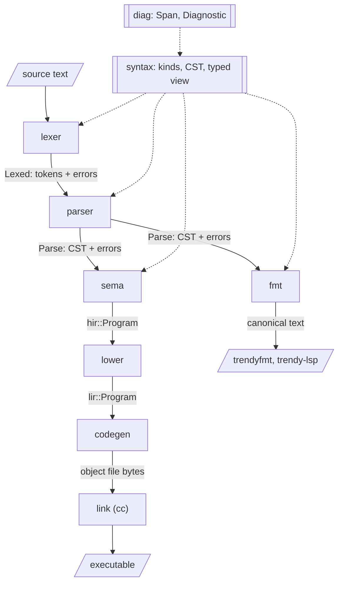

# Compiler pipeline

The compiler is split into layers, and each layer is a separate crate. A
layer reads the output of the layer above it and produces the input for the
layer below. Layers never call each other: small programs called drivers
connect them. `trendyc` is the compiler driver, and the formatter and language
server are drivers that reuse the front-end layers.

This document is about the compiler. For the language itself, see
[`language.md`](language.md).



The front end never stops at the first error. The lexer and parser always
produce a complete, lossless syntax tree and collect every error along the
way. The compiler stops after parsing if there were any errors, but the
language server keeps the tree so it can still answer questions about the
file.

## Layers

### diag (`trendy_diag`)

**Provides:** `Span`, a byte range in the source, and `Diagnostic` (see
[Diagnostics](#diagnostics)), along with the error `Code` registry and its
explanations. It renders diagnostics both as text with source excerpts and as
JSON.

**Must not:** know about any other stage. Every front-end layer depends on it,
so it stays at the bottom of the graph.

### syntax (`trendy_syntax`)

**Provides:**
- `SyntaxKind`, the kind of every token and node.
- The concrete syntax tree (CST), and `TreeBuilder` for constructing it.
- A typed view over the tree (`ast::SourceFile`, `ast::Operator`, …) with
  accessors that return `Option`, because a tree with errors can be missing
  any part.
- `literal`, the meaning of literals: the escape table, the integer syntax,
  and decoding. The lexer uses it to report malformed literals, and sema uses
  it (through `ast::Literal::value`) to decode them, so the rules exist in
  one place.

The CST is lossless. It holds every byte of the source, including whitespace
and text that failed to parse, so printing it reproduces the input exactly.

**Owns:** the tree representation, which is built on `rowan`. **Must not:**
let `rowan` leak. No other crate may depend on it, so it could be replaced
without touching any other layer.

### lexer (`trendy_lexer`)

**Input:** source text. **Output:** `Lexed`, the tokens plus an error for each
unrecognized character and malformed literal.

The tokens cover the source exactly, whitespace included. Each token is a kind
plus a span, and doesn't copy its text out of the source. The lexer never
fails: an unrecognized character becomes an error token, and lexing
continues.

**A malformed literal keeps the kind it was meant to have.** For example,
`1_000` is still an integer literal and `"abc` is still a text literal, so the
parser accepts them, and the mistake gives one error, not a cascade. An
unterminated text literal ends at the end of its line, or just before a final
`;` on that line, which is most likely where the closing quote was meant to
go.

**Owns:** what counts as whitespace, identifiers, keywords, literals and
punctuation.
**Must not:** know the grammar. It never looks at more than one token at a
time to decide anything.

### parser (`trendy_parser`)

**Input:** source text and `Lexed`. **Output:** `Parse`, the CST plus every
lexer and parser error, ordered by position.

**Owns:** the grammar, using recursive descent with one token of lookahead.
It never fails. A missing token is reported and the parser carries on, and
text that fits nowhere is wrapped in an error node, up to the next definition
keyword (`operator` or `var`). In a variable declaration, a missing `:` or
`:=` is recognized from the type or value that follows it, and `=` is parsed
as `:=` and reported. Whitespace is attached to the innermost node that is open when it
appears, so whitespace between definitions belongs to the file.

**Must not:** resolve names, check meaning, or reject a program that is
grammatically valid. For example, "no `main`", "duplicate name" and "unknown
type" are sema errors, not parse errors.

### fmt (`trendy_fmt`)

**Input:** the CST of a file with no syntax errors. **Output:** the file as
text in canonical style.

**Owns:** the language's layout. Whatever this crate prints is, by definition,
the official style. **Must not:** depend on sema. Formatting is purely
syntactic, so a program that parses but has semantic errors can still be
formatted.

The canonical layout is one definition per line. Consecutive variable
declarations go on adjacent lines, unless the source separates them with a
blank line to group them, in which case one blank line is kept. Other
definitions are always separated by a blank line. This is the only place the
formatter looks at the original whitespace.

Everything else goes on one line, except that a relation value with more than
one tuple is broken across lines: each tuple on its own line, indented four
spaces per level of nesting, with the closing brace on a line of its own.

The formatter reprints the CST's tokens in order and decides only the
whitespace between them. Because it never adds, drops, or reorders any other
token, it can't change what a program means, and it will keep comments
intact once they exist. It must also be idempotent: formatting its own output
changes nothing.

### hir (`trendy_hir`)

**Provides:** the high-level IR, which is the checked program. It is
tree-shaped like the source, but names are resolved into indices (such as
`OperatorId`), and every invariant sema promises holds. Relational algebra
will live here, and the optimizer will rewrite it.

It holds the operators, the variables, and the built-in types (`Type`) and
values (`Value`). Every variable has an explicit type and initial value: sema
infers whichever one the source leaves out.

Types are built-in scalars (`Scalar`), tuples (`Type::Tuple`) or relations
(`Type::Relation`). A tuple or relation type's `Heading` maps attribute names
to types. It is sorted by name,
because attributes are unordered (TTM RM Proscription 1), and the sorted
order is also the canonical order for display and layout. Types are
structural: two tuple types, or two relation types, are equal exactly when
their headings are. A relation value carries its heading, because an empty
one has no tuples to take it from, and keeps its tuples in a sorted set.
Values are totally ordered only so that they can be kept in sorted sets; the
order has no meaning in the language.

Every type's equality must hold exactly when no operator can tell two values
apart (TTM RM Prescription 8). For rationals, that is IEEE 754 totalOrder.
`hir::Rational` implements it, and every comparison, ordering or hash of a
rational goes through that type, never through `f64` operators.

**Must not:** refer to syntax: no tokens, no CST, no spans. When debug info
arrives, source locations come back as a separate, explicit HIR field rather
than as `Span`.

### sema (`trendy_sema`)

**Input:** the CST of a file with no syntax errors. **Output:** `hir::Program`,
or every semantic error found.

**Owns:** name resolution, type checking, and translating the CST to HIR.
**It is the last layer allowed to report an error to the user.**

There are two namespaces. Variables and operators share the value namespace,
so no two of them can have the same name. Types have their own namespace, so a
variable can be named after a type. Sema collects every name before checking
anything, so errors can refer to definitions anywhere in the file.

A variable without a value gets its type's default (`0`, `""`), and one
without a type gets its value's type. These are the two options *The Third
Manifesto* allows for initialization (RM Prescription 11).

Checking is bidirectional: the expected type flows down into a value
(`types::Expected`), along with where it came from (`types::Origin`): a
written type, a selector's heading, or an earlier value such as a relation's
first tuple. That is how an empty relation gets its heading from context, and
how each error's secondary label points at the source of the expectation.

A value is checked against its expected type structurally, and a problem is
reported at the innermost place it occurs. A wrong scalar deep inside a
nested tuple is reported at that literal, with the attribute's declared type
as the secondary label. Missing and unknown attributes are reported at the
tuple value. An unknown attribute close to a missing one is reported once,
with a rename that fixes both.

### lir (`trendy_lir`)

**Provides:** the low-level IR. A function is a control-flow graph of basic
blocks, and each block ends in a terminator. Blocks will hold instructions
once the language has expressions. There is no nesting and nothing implicit:
every jump and return is spelled out.

It also describes static data (`Data`) field by field, rather than as bytes,
so the description doesn't depend on the target. Values are represented like
this:

- `boolean`: one byte, `0` for false and `1` for true.
- `integer`: one 64-bit field.
- `rational`: one 64-bit IEEE 754 binary floating-point field.
- a tuple: a `Struct` of its attributes' fields, in name order.
- a relation: the address of a read-only array of its tuples, in sorted
  order, followed by the number of tuples.
- `text`: the address of a read-only constant holding the UTF-8 bytes,
  followed by the length in bytes, the size of a pointer.

A `Struct` is aligned to its widest field and padded to a multiple of that
alignment, so a tuple has the same layout embedded in another tuple as it has
on its own. That is what lets an attribute be used, and later passed to an
operator, as a value in its own right. Reordering attributes by alignment to
save padding would be a valid later optimization, since attribute order has no
meaning.

**Must not:** contain high-level constructs. Anything codegen would have to
"figure out" belongs in lowering instead, so codegen stays a direct
translation.

### lower (`trendy_lower`)

**Input:** `hir::Program`. **Output:** `lir::Program`. It cannot fail.

**Owns:** turning tree-shaped code into control flow, and choosing how each
value is represented in memory. Once relations arrive, this is where
relational operators get fused into loops over tuples with fixed layouts.

### codegen (`trendy_codegen`)

**Input:** `lir::Program`. **Output:** object file bytes for the host target,
produced with Cranelift.

**Owns:**
- symbol mangling: `trendy_op_<name>` for operators, `trendy_var_<name>` for
  variables, and `trendy_const_<index>` for constants, all local;
- laying out data for the target's byte order and pointer size, where every
  object occupies at least one byte;
- calling conventions, and the C-ABI `main` entry shim.

When comparison operators arrive, rational comparisons must compile to
totalOrder (an integer comparison on the bits, after flipping the bits of
negative values), not to the target's floating-point compare instructions.
LIR carries rationals as exact bits (`Field::F64Bits`) for the same reason. **Must not:** see syntax, or produce user-facing
errors. Any error it returns is a compiler bug, and the driver reports it as
`internal compiler error`.

### Drivers

Drivers read input, run the layers they need in order, and present the
results. They contain no language logic of their own.

- **`trendyc`**, the compiler: runs lexer, parser, sema, lower and codegen,
  renders diagnostics (`--error-format=human|json`), and links the object
  with the system `cc`. `trendyc --explain <code>` prints an error code's
  explanation.
- **`trendyfmt`**, the formatter command: runs lexer, parser and fmt, then
  rewrites files in place. With `--check`, it lists unformatted files and
  exits non-zero instead.
- **`trendy-lsp`** (crate `trendy_lsp`), the language server, speaking LSP over
  stdio. On every change it reports all lexer and parser errors, or, if there
  are none, all sema errors. It offers each suggestion as a quick fix,
  provides semantic highlighting by classifying tokens in the CST (so
  highlighting always agrees with the compiler, even in broken files), and answers formatting requests with fmt. It also converts
  byte spans to the UTF-16 positions LSP uses. The VS Code extension in
  `editors/vscode` is its client. The extension's TextMate grammar, used
  for instant coloring before the server starts, is generated from the
  lexer by `crates/lsp/tests/textmate.rs`, which fails if the committed
  grammar is out of date.

## Diagnostics

Most trendy code is expected to be written by language models, which fix
code by reading the diagnostics and editing. So diagnostics are a primary
interface of the compiler, and every one of them must be actionable without
guesswork.

- **Stable code.** Every diagnostic has a `Code` (`E0002`). Codes are never
  reused or renumbered. `E00xx` are syntax errors and `E01xx` are semantic
  errors. Each code has an explanation in `crates/diag/errors/<code>.md`,
  printed by `trendyc --explain <code>`. The explanation must contain a failing
  example in a ```` ```trendy,error ```` block and a corrected one in a
  ```` ```trendy ```` block, and `crates/trendyc/tests/explanations.rs`
  compiles both.
- **The primary label is where the fix goes.** For something missing, that is
  an empty span directly after the previous token, not the token where the
  parser noticed the problem.
- **Secondary labels give the context,** such as where a name was first
  defined, or where the next definition starts.
- **Notes give the relevant language rule,** such as the form of a
  definition, so the reader doesn't need outside knowledge.
- **Suggestions carry a fix whenever it is mechanical.** A suggestion is a set
  of exact edits. Applying them must resolve that diagnostic, and the
  explanations test checks this for every failing example. When the fix needs
  a decision, such as which of two duplicate definitions to rename, use help
  text instead of guessing.
- **One mistake gives one diagnostic.** Consecutive missing tokens merge into
  a single error with a single insertion. Recovery never reports tokens that
  were only skipped because of an earlier error.
- **Common mistakes are recognized and named,** especially habits from other
  languages: `fn`, `void` or `def` instead of `operator`, and `()` parameter
  lists or `{}` bodies. Each gets a precise message and a fix.

Every channel carries all of this. `--error-format=json` gives one object per
diagnostic, with offsets, lines, columns, labels and edits. The language
server sends the code, related locations, and all notes and help in the
message, and offers each suggestion as a quick fix.

## Rules

1. **Dependencies point down.** A layer may depend only on layers above it in
   the `layers` block below, and only on the ones listed for it there.
2. **One handoff type per boundary.** Layers communicate through one data
   type: tokens, then the CST, then HIR, then LIR. Nothing reaches past the
   layer next to it, so codegen never imports HIR, for example.
3. **User errors stop at sema.** After sema, failures are internal errors.
4. **Only drivers wire layers together.** No layer calls the next one.
5. **Tests may look upstream.** A crate's tests may use layers earlier in the
   pipeline to build their input, such as sema's tests lexing and parsing
   source text. Tests may never depend on a later layer.

## Enforcement

Every layer is its own crate, so the compiler rejects any `use` of a crate
that isn't declared as a dependency. That turns the rules into a question of
which dependencies each crate's manifest declares. The test
`crates/trendyc/tests/layers.rs` runs `cargo metadata` and checks the
declarations against the block below:

- Every workspace crate appears in the block exactly once, and nothing else
  does.
- Each crate's `[dependencies]` and `[build-dependencies]` must equal its line
  exactly, workspace and external crates alike. A new dependency, such as
  Cranelift showing up anywhere besides codegen, means editing this document.
- A crate's line may name only workspace crates listed above it.
- Workspace crates in `[dev-dependencies]` must be listed above the crate
  (rule 5). External dev-dependencies are unrestricted.

To add a layer, insert its line where it belongs in pipeline order, add a
section above that describes it, and create the crate.

```layers
# crate          dependencies
trendy_diag    : serde_json
trendy_syntax  : trendy_diag rowan
trendy_lexer   : trendy_diag trendy_syntax
trendy_parser  : trendy_diag trendy_syntax trendy_lexer
trendy_fmt     : trendy_syntax
trendy_hir     :
trendy_sema    : trendy_diag trendy_syntax trendy_hir
trendy_lir     :
trendy_lower   : trendy_hir trendy_lir
trendy_codegen : trendy_lir cranelift-codegen cranelift-frontend cranelift-module cranelift-native cranelift-object
trendyc        : trendy_diag trendy_lexer trendy_parser trendy_sema trendy_lower trendy_codegen
trendyfmt      : trendy_diag trendy_lexer trendy_parser trendy_fmt
trendy_lsp     : trendy_diag trendy_syntax trendy_lexer trendy_parser trendy_sema trendy_fmt lsp-server lsp-types serde_json
```

## Planned layers

None of these exist yet. They're here so the boundaries are planned before the
code needs them.

- **Relational algebra in HIR**, once relations arrive. Sema would translate
  relational expressions into algebra operators over known headings.
- **Optimizer** (`trendy_opt`), from HIR to HIR, placed between sema and
  lower. It would apply algebraic rewrites such as predicate pushdown and join
  ordering. It goes in its own layer so that sema checks and lower translates,
  and neither has to optimize.
- **Runtime** (`trendy_runtime`), a `no_std` static library linked into every
  executable. It isn't part of the compiler pipeline, so no compiler layer
  depends on it; codegen only emits calls to symbols it exports.
